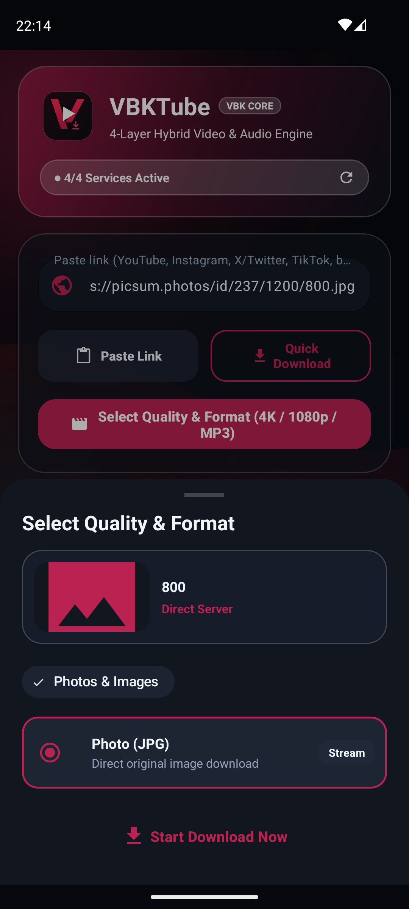
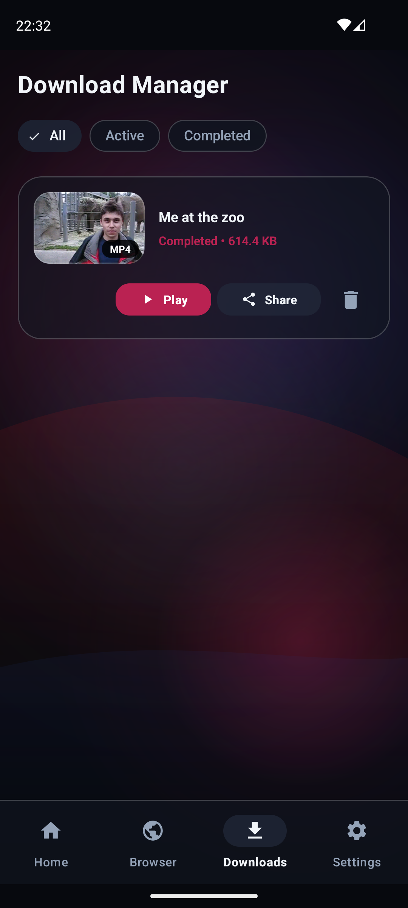
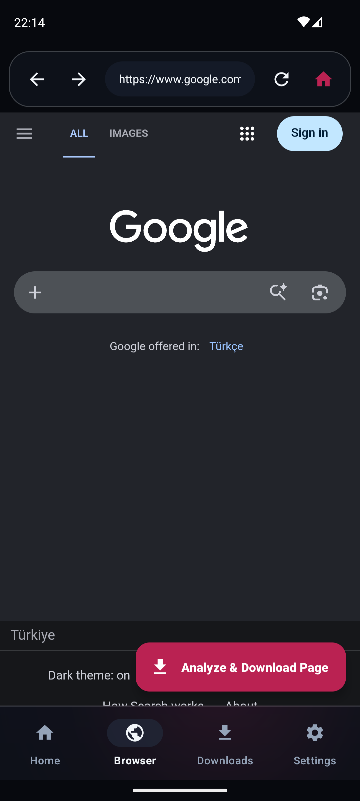

<p align="center">
  
</p>

<h1 align="center">VBKTube</h1>

<p align="center">
  Open-source Android app to download videos, audio and images from YouTube, Instagram, TikTok, X, Reddit and 1000+ other sites.
</p>

<p align="center">
  <a href="https://github.com/abilalk1/VBKTube/releases/latest"></a>
</p>

<p align="center">
  
  
  
</p>

<p align="center">
  🇬🇧 English | <a href="README.tr.md">🇹🇷 Türkçe</a>
</p>

---

## Screenshots

<p align="center">
  
  
  
  
  
</p>

## Features

**Downloading**
- **Paste a link and download.** Choose the quality and format, or use one-tap quick download.
- **Download without leaving your app.** Tap Share in YouTube, Instagram, TikTok, X or any other app and choose VBKTube. A small panel pops up right over that app where you pick the quality (or the slides you want) and start the download. VBKTube does not even open, and you stay where you were.
- **Video, audio or image.** MP4 in the qualities the source really offers, MP3 or original M4A audio, and JPG/PNG/WebP/GIF images (including Google Images links).
- **Multi-select.** Pick only the slides you want from carousels, galleries and story sets.
- **Many sites, with special care for the big ones:**
  - **YouTube:** videos and Shorts, with separate video and audio streams merged for you.
  - **Instagram:** posts, Reels, carousels, stories and highlights. Posts with music can be saved as a video with the music, or just the audio. Stories need a one-time login in the built-in browser.
  - **X / Twitter:** HD video and GIFs.
  - **TikTok:** HD without watermark, and the sound as MP3.
  - **Reddit:** videos (video and audio merged into one MP4) and image galleries.
  - **Facebook, Vimeo and 1000+ more** through yt-dlp.
- **Streams and odd links.** `.m3u8` (HLS) streams are converted to MP4. Links without a file extension are checked by their content type, and pages with an embedded video are scanned for it.

**Built-in browser**
- Ad blocking and a media detector that lists the videos and images playing on the page, so you can download what you see.
- Log in to a site once and VBKTube can download private or login-only content you have access to.
- Fullscreen video and your own shortcuts for favorite sites.

**Download manager**
- Downloads run in the background, two at a time, with progress notifications and a separate notification when one finishes or fails.
- Cancel, retry, play in the built-in player, share or delete (with or without the file).
- Finished files are saved to your gallery and music library, in a `VBKTube` folder.
- Clear messages when something goes wrong (no internet, expired link, not enough space, login required...), and downloads interrupted by closing the app are marked as such.

**App**
- Dark, light or system theme. English and Turkish.
- Update checks against GitHub Releases (can be turned off), and a button to update the yt-dlp engine from inside the app. Pick the Nightly or Stable yt-dlp channel.
- No ads, no tracking, no account. See [Privacy](#privacy).

## Install

1. Download the latest `app-universal-release.apk` (or the one for your CPU, usually `arm64-v8a`) from [Releases](https://github.com/abilalk1/VBKTube/releases/latest).
2. Open the file on your phone and allow installing from this source when Android asks.
3. Open VBKTube, paste a link, and tap **Select Quality & Format**.

VBKTube is not on Google Play, because Play does not allow apps that download from YouTube.

## Build from source

Requirements: Android Studio (or JDK 17) and the Android SDK.

```bash
git clone https://github.com/abilalk1/VBKTube.git
cd VBKTube
./gradlew assembleDebug
```

The APKs are written to `app/build/outputs/apk/debug/`.

Opening the project in Android Studio sets up the Android SDK path for you. When building from the command line, create a `local.properties` file with `sdk.dir=/path/to/Android/Sdk` (or set `ANDROID_HOME`).

## How it works

Each link goes through these steps until one succeeds:

1. **Direct media:** links to `.mp4`, `.mp3`, `.m3u8`, images and so on. Links without an extension are checked by their content type.
2. **Platform extractors:** NewPipeExtractor for YouTube, and dedicated extractors for Instagram, X, TikTok and Reddit.
3. **yt-dlp:** the universal fallback for 1000+ sites. FFmpeg merges separate video and audio streams.
4. **Page scan:** looks for embedded video in the page (Open Graph, `<video>`, JSON-LD).

## Privacy

VBKTube has no ads, no analytics and no account, and it does not send anything to the developer. Still, you should know where your links go:

- Downloads go straight from the site to your phone. For some sites VBKTube asks **public helper services** for the media address, and those services see the link you are downloading: `tikwm.com` for TikTok, `api.fxtwitter.com`, `api.vxtwitter.com` and Twitter's own syndication endpoint for X, and `ddinstagram.com` and `kkinstagram.com` as a fallback for Instagram. If you do not want that, do not use these sites with VBKTube.
- GitHub is contacted to check for new VBKTube releases and to update yt-dlp. You can turn off the automatic release check in Settings.
- Cookies from the built-in browser stay on your device. When VBKTube needs them for a download, it exports only the cookies of that site into a temporary file, which is deleted when the download step ends.
- App data is excluded from Android backups.

## Known limitations

- Sites change often, so a downloader that works today can break tomorrow. If a link stops working, update yt-dlp in **Settings** first, then open an issue.
- In English mode, some format names for Instagram, X, TikTok and Reddit are still shown in Turkish. This is cosmetic and will be fixed in a later release.
- Instagram stories and some private content need a one-time login in the built-in browser.

## Disclaimer

VBKTube is intended for **personal use** and for content you have the right to download, such as your own uploads, public-domain or Creative Commons material, or content whose owner allows downloading.

- You are responsible for complying with copyright law and with the terms of service of the sites you use. Downloading may be against a site's terms.
- VBKTube is **not affiliated with, endorsed by, or sponsored by** YouTube, Google, Instagram, Meta, TikTok, ByteDance, X, Reddit, or any other service. All trademarks belong to their owners.
- The software is provided "as is", without any warranty, as described in the [license](LICENSE).

## Credits

VBKTube is built on these open-source projects:

- [yt-dlp](https://github.com/yt-dlp/yt-dlp) (Unlicense), via [youtubedl-android](https://github.com/JunkFood02/youtubedl-android) (GPL-3.0)
- [NewPipeExtractor](https://github.com/TeamNewPipe/NewPipeExtractor) (GPL-3.0)
- [FFmpeg](https://ffmpeg.org/) (LGPL/GPL) and [aria2](https://aria2.github.io/) (GPL-2.0)
- AndroidX, Material Components, Room, OkHttp, Glide and ExoPlayer (Apache-2.0)

## License

VBKTube is free software, licensed under the [GNU General Public License v3.0](LICENSE).
