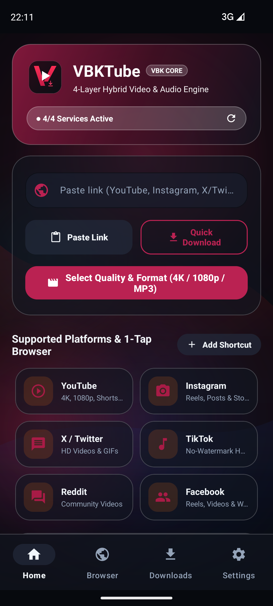
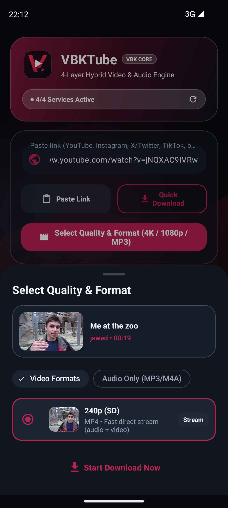

<p align="center">
  
</p>

<h1 align="center">VBKTube</h1>

<p align="center">
  Open-source Android app to download videos, audio and images from YouTube, Instagram, TikTok, X, Reddit and 1000+ other sites.
</p>

<p align="center">
  <a href="https://github.com/abilalk1/VBKTube/releases/latest"></a>
</p>

<p align="center">
  
  
  
</p>

<p align="center">
  🇬🇧 English | <a href="README.tr.md">🇹🇷 Türkçe</a>
</p>

---

## Screenshots

<p align="center">
  
  
  
  
  
</p>

## Features

- **Paste a link and download.** Choose the quality and format, or use one-tap quick download.
- **Many sites.** YouTube (videos and Shorts), Instagram (Reels, posts, carousels, stories), TikTok (without watermark), X/Twitter, Reddit, Facebook, Vimeo and 1000+ more via yt-dlp.
- **Video, audio or image.** MP4 in the qualities the source really offers, MP3/M4A audio, and JPG/PNG/WebP/GIF images (including Google Images links).
- **Multi-select.** Pick only the slides you want from carousels, galleries and story sets.
- **Built-in browser.** Ad blocking, plus a media detector that finds the video or image playing on the page.
- **Share to download.** Share a link from any app to VBKTube to start a download.
- **Download manager.** Background downloads with progress notifications, cancel, retry, and a built-in player.
- **Dark and light themes, English and Turkish.**
- **No ads, no tracking, no account.** Nothing is sent to us. Cookies from the built-in browser stay on your device.

## Install

1. Download the latest `app-universal-release.apk` (or the one for your CPU, usually `arm64-v8a`) from [Releases](https://github.com/abilalk1/VBKTube/releases/latest).
2. Open the file on your phone and allow installing from this source when Android asks.
3. Open VBKTube, paste a link, and tap **Select Quality & Format**.

VBKTube is not on Google Play, because Play does not allow apps that download from YouTube.

## Build from source

Requirements: Android Studio (or JDK 17) and the Android SDK.

```bash
git clone https://github.com/abilalk1/VBKTube.git
cd VBKTube
./gradlew assembleDebug
```

The APKs are written to `app/build/outputs/apk/debug/`.

## How it works

Each link goes through these steps until one succeeds:

1. **Direct media:** links to `.mp4`, `.mp3`, `.m3u8`, images and so on. Links without an extension are checked by their content type.
2. **Platform extractors:** NewPipeExtractor for YouTube, and dedicated extractors for Instagram, X, TikTok and Reddit.
3. **yt-dlp:** the universal fallback for 1000+ sites. FFmpeg merges separate video and audio streams.
4. **Page scan:** looks for embedded video in the page (Open Graph, `<video>`, JSON-LD).

## Disclaimer

VBKTube is intended for **personal use** and for content you have the right to download, such as your own uploads, public-domain or Creative Commons material, or content whose owner allows downloading.

- You are responsible for complying with copyright law and with the terms of service of the sites you use. Downloading may be against a site's terms.
- VBKTube is **not affiliated with, endorsed by, or sponsored by** YouTube, Google, Instagram, Meta, TikTok, ByteDance, X, Reddit, or any other service. All trademarks belong to their owners.
- The software is provided "as is", without any warranty, as described in the [license](LICENSE).

## Credits

VBKTube is built on these open-source projects:

- [yt-dlp](https://github.com/yt-dlp/yt-dlp) (Unlicense), via [youtubedl-android](https://github.com/JunkFood02/youtubedl-android) (GPL-3.0)
- [NewPipeExtractor](https://github.com/TeamNewPipe/NewPipeExtractor) (GPL-3.0)
- [FFmpeg](https://ffmpeg.org/) (LGPL/GPL) and [aria2](https://aria2.github.io/) (GPL-2.0)
- AndroidX, Material Components, Room, OkHttp, Glide and ExoPlayer (Apache-2.0)

## License

VBKTube is free software, licensed under the [GNU General Public License v3.0](LICENSE).
