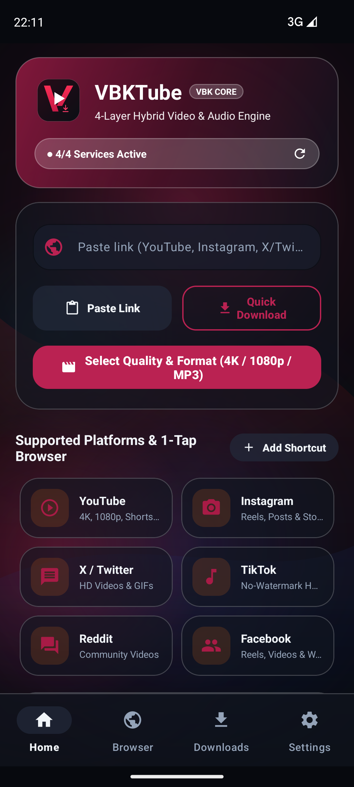
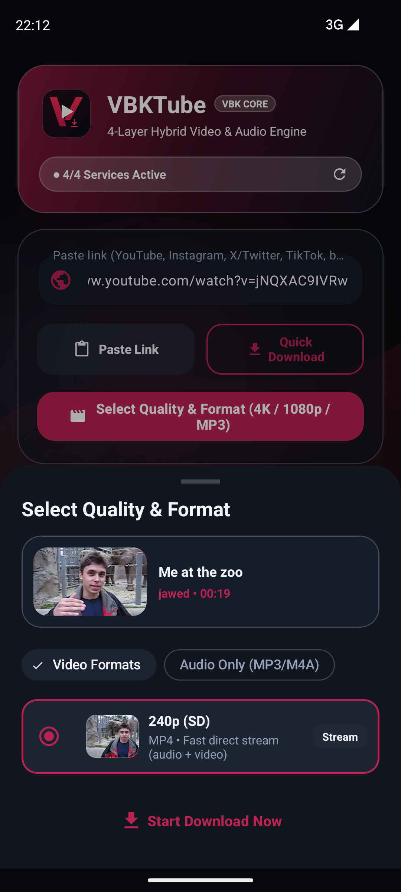
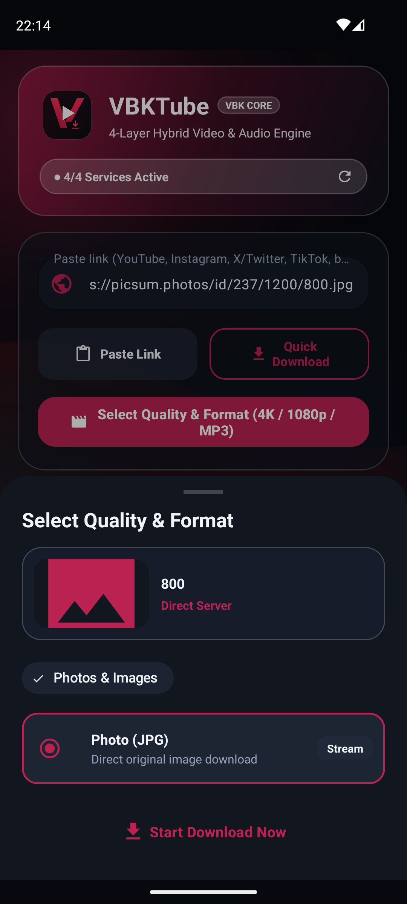
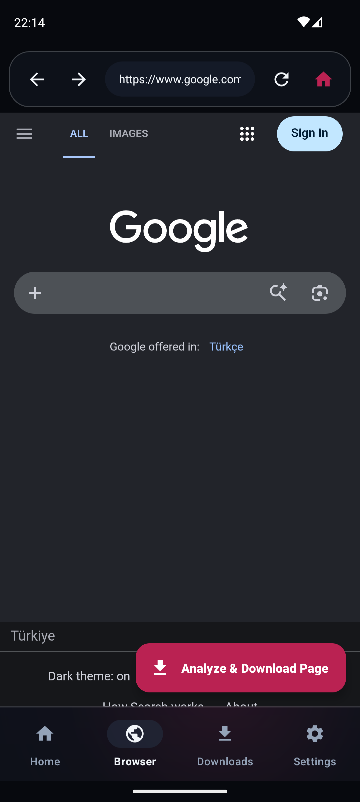

<p align="center">
  
</p>

<h1 align="center">VBKTube</h1>

<p align="center">
  YouTube, Instagram, TikTok, X, Reddit ve 1000'den fazla siteden video, ses ve görsel indiren açık kaynaklı Android uygulaması.
</p>

<p align="center">
  <a href="https://github.com/abilalk1/VBKTube/releases/latest"></a>
</p>

<p align="center">
  
  
  
</p>

<p align="center">
  <a href="README.md">🇬🇧 English</a> | 🇹🇷 Türkçe
</p>

---

## Ekran Görüntüleri

<p align="center">
  
  
  
  
</p>

## Özellikler

- **Bağlantıyı yapıştır, indir.** Kaliteyi ve biçimi seç ya da tek dokunuşla hızlı indir.
- **Birçok site.** YouTube (videolar ve Shorts), Instagram (Reels, gönderiler, albümler, hikâyeler), TikTok (filigransız), X/Twitter, Reddit, Facebook, Vimeo ve yt-dlp sayesinde 1000'den fazla site daha.
- **Video, ses veya görsel.** Kaynağın gerçekten sunduğu kalitelerde MP4, MP3/M4A ses ve JPG/PNG/WebP/GIF görseller (Google Görseller bağlantıları dahil).
- **Çoklu seçim.** Albümlerden, galerilerden ve hikâye gruplarından sadece istediğin kareleri seç.
- **Dahili tarayıcı.** Reklam engelleme ve sayfada oynayan video ya da görseli bulan medya algılayıcı.
- **Paylaşarak indir.** Herhangi bir uygulamadan bir bağlantıyı VBKTube'a paylaşarak indirmeyi başlat.
- **İndirme yöneticisi.** İlerleme bildirimli arka plan indirmeleri, iptal, yeniden deneme ve dahili oynatıcı.
- **Koyu ve açık tema, İngilizce ve Türkçe.**
- **Reklam yok, takip yok, hesap yok.** Bize hiçbir şey gönderilmez. Dahili tarayıcının çerezleri cihazında kalır.

## Kurulum

1. [Releases](https://github.com/abilalk1/VBKTube/releases/latest) sayfasından en son `app-universal-release.apk` dosyasını (ya da işlemcine uygun olanı, genellikle `arm64-v8a`) indir.
2. Dosyayı telefonunda aç ve Android sorduğunda bu kaynaktan yüklemeye izin ver.
3. VBKTube'u aç, bir bağlantı yapıştır ve **Kalite ve Biçim Seç**'e dokun.

VBKTube, Google Play'de yer almaz, çünkü Play, YouTube'dan indirme yapan uygulamalara izin vermez.

## Kaynaktan derleme

Gereksinimler: Android Studio (ya da JDK 17) ve Android SDK.

```bash
git clone https://github.com/abilalk1/VBKTube.git
cd VBKTube
./gradlew assembleDebug
```

APK dosyaları `app/build/outputs/apk/debug/` klasörüne yazılır.

## Nasıl çalışır?

Her bağlantı, biri başarılı olana kadar şu adımlardan geçer:

1. **Doğrudan medya:** `.mp4`, `.mp3`, `.m3u8`, görseller vb. bağlantılar. Uzantısız bağlantılar içerik türüne göre kontrol edilir.
2. **Platform çıkarıcıları:** YouTube için NewPipeExtractor; Instagram, X, TikTok ve Reddit için özel çıkarıcılar.
3. **yt-dlp:** 1000'den fazla site için evrensel yedek yöntem. FFmpeg, ayrı video ve ses akışlarını birleştirir.
4. **Sayfa taraması:** Sayfadaki gömülü videoyu arar (Open Graph, `<video>`, JSON-LD).

## Sorumluluk Reddi

VBKTube, **kişisel kullanım** ve indirme hakkına sahip olduğun içerikler içindir; örneğin kendi yüklemelerin, kamu malı ya da Creative Commons içerikler veya sahibinin indirmeye izin verdiği içerikler.

- Telif hakkı yasalarına ve kullandığın sitelerin hizmet şartlarına uymak senin sorumluluğundadır. İndirme işlemi bir sitenin şartlarına aykırı olabilir.
- VBKTube; YouTube, Google, Instagram, Meta, TikTok, ByteDance, X, Reddit veya başka hiçbir hizmetle **bağlantılı değildir, onlar tarafından onaylanmamıştır ve desteklenmemektedir**. Tüm ticari markalar sahiplerine aittir.
- Yazılım, [lisansta](LICENSE) açıklandığı üzere hiçbir garanti verilmeksizin "olduğu gibi" sunulur.

## Katkıda Bulunanlar

VBKTube şu açık kaynaklı projeler üzerine kuruludur:

- [yt-dlp](https://github.com/yt-dlp/yt-dlp) (Unlicense), [youtubedl-android](https://github.com/JunkFood02/youtubedl-android) (GPL-3.0) aracılığıyla
- [NewPipeExtractor](https://github.com/TeamNewPipe/NewPipeExtractor) (GPL-3.0)
- [FFmpeg](https://ffmpeg.org/) (LGPL/GPL) ve [aria2](https://aria2.github.io/) (GPL-2.0)
- AndroidX, Material Components, Room, OkHttp, Glide ve ExoPlayer (Apache-2.0)

## Lisans

VBKTube özgür yazılımdır ve [GNU Genel Kamu Lisansı v3.0](LICENSE) ile lisanslanmıştır.
